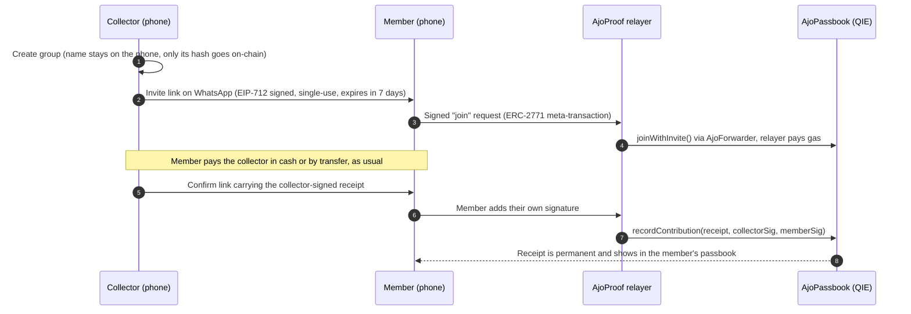
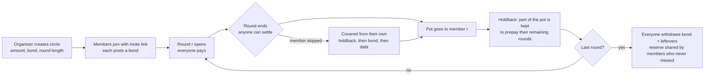
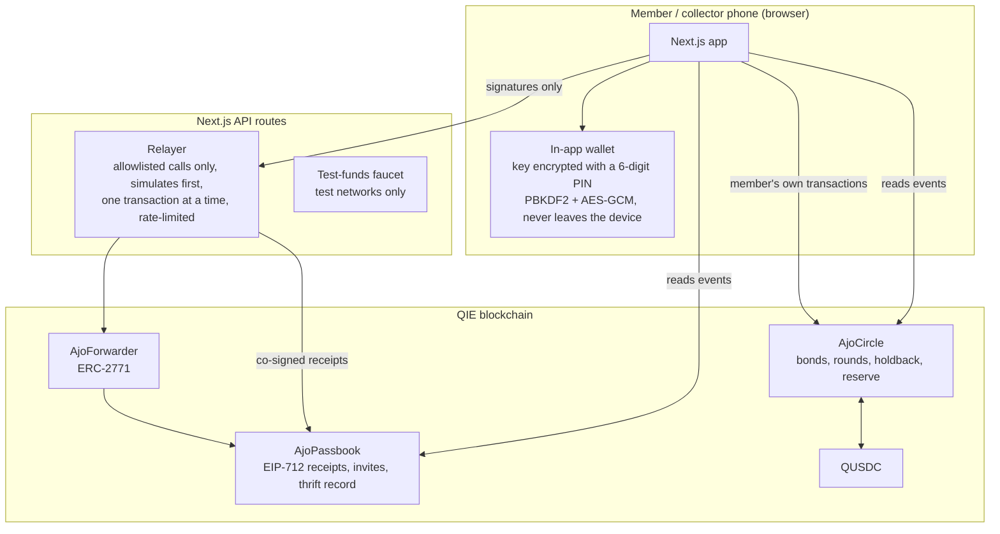

# AjoProof

**Your ajo, verifiable.** Co-signed thrift receipts nobody can change or deny, and savings circles enforced by code, on the QIE blockchain.

Ajo, esusu and adashe are rotating savings groups used by millions of people across West Africa. They run on trust, and that trust breaks in familiar ways. A collector disappears with the money. A member insists "I paid" and the collector says "you didn't". Years of disciplined saving leave no record a lender will accept.

AjoProof keeps the ajo people already run and adds proof:

| | **Passbook mode** | **Circle mode** |
|---|---|---|
| For | Cash and bank-transfer ajo with a collector | Groups saving in a dollar stablecoin |
| Money | Never touches AjoProof | Held by an open-source contract, never by us |
| What goes on-chain | Receipts signed by **both** collector and member | Every payment, payout, bond and missed round |
| Member needs | A phone browser. No app, no crypto, no fees | QUSDC plus a little QIE for fees |

---

## How it works

### Passbook mode: two signatures, one truth



A receipt is only recorded when **both** signatures match the exact amount, period, date and a one-time payment reference. A collector can't invent a payment, a member can't deny one, and nobody can edit or delete a recorded receipt. Every receipt also builds the member's on-chain **thrift record**: groups joined, payments made and payouts received, starting from their first saving date.

### Circle mode: rules nobody can bend



**Payout holdback** closes the classic ajo loophole, where someone takes the pot early and stops paying. When a member receives the pot, the contract keeps back whatever part of their remaining contributions their bond doesn't already cover. It then prepays their next rounds automatically. Walking away after being paid can't cost anyone else a cent. The test suite proves this, and `npm run demo` shows it happening.

---

## Architecture



- **No database.** Invites and receipts travel as signed links. Every number in the app, including the public [stats page](web/src/app/stats/page.tsx), is read from contract events.
- **Privacy:** group names are stored on-chain only as a `keccak256` hash, and members only as an opaque code. Names and phone numbers stay on the devices that typed them.
- **Never holds naira.** Passbook mode only records payments; the cash and transfers stay between members and their collector.

---

## Contracts

| Contract | What it does |
|---|---|
| [`AjoPassbook.sol`](contracts/AjoPassbook.sol) | Groups and members, single-use signed invite links, co-signed contribution and payout receipts (EIP-712, EIP-1271-compatible), per-wallet thrift record |
| [`AjoForwarder.sol`](contracts/AjoForwarder.sol) | OpenZeppelin ERC-2771 forwarder, so members act without holding gas |
| [`AjoCircle.sol`](contracts/AjoCircle.sol) | Rotating savings circle for 2–50 members: bonds, ordered rounds, permissionless settlement, payout holdback, debt deduction, shared reserve |

Security choices:
- `ReentrancyGuard` and `SafeERC20` on every function that moves funds.
- Rounds settle strictly in order, and payment references and invites can't be reused.
- Signatures are bound to the chain and the deployment.
- Nobody, including the deployer, can move funds outside the circle rules: there are no admin keys.

Deployed addresses: see [`deployments/`](deployments) and the in-app **Stats** page, which links each contract on the QIE explorer.

---

## Run it locally

Requirements: Node.js 20+.

```bash
npm install
npm --prefix web install
```

```bash
npm test
```

```bash
npm run demo
```

`npm run demo` is a narrated walkthrough on an in-memory chain. It shows co-signed receipts, cheating attempts being blocked, and a circle where one member walks away after being paid.

To use the app against a local chain:

```bash
npx hardhat node
```

```bash
npm run deploy:local
```

```bash
cp web/.env.example web/.env.local
```

Set `RELAYER_PRIVATE_KEY` in `web/.env.local`. For local use only, a Hardhat test account's key works. Then start the app:

```bash
npm --prefix web run dev -- --port 3107
```

Open two different origins, such as `http://127.0.0.1:3107` and `http://localhost:3107`, to act as two people with separate wallets.

## Deploy to QIE

1. Create fresh deployer and relayer wallets. Their keys go straight into the git-ignored `.env` and `web/.env.local`, and only the addresses are printed:

   ```bash
   npm run wallets:testnet
   ```

   Send a little QIE to both addresses (testnet QIE: https://www.qie.digital/faucet). Never use a personal wallet's key.
2. Deploy:

   ```bash
   npm run deploy:testnet
   ```

   Mainnet uses real QUSDC from `QUSDC_ADDRESS`:

   ```bash
   npm run deploy:mainnet
   ```

3. Verify the source on the QIE explorer (Blockscout):

   ```bash
   npx hardhat verify --network qieTestnet <address> [constructor args]
   ```

4. In `web/.env.local`:
   - set `NEXT_PUBLIC_NETWORK` to `qieTestnet` or `qieMainnet`
   - the relayer key for that network (`RELAYER_PRIVATE_KEY_QIETESTNET` / `_QIEMAINNET`) is already there from step 1

Network details: mainnet chain 1990 (`https://rpc1mainnet.qie.digital`), testnet chain 1983 (`https://rpc1testnet.qie.digital`), explorers `mainnet.qie.digital` / `testnet.qie.digital`.

## Project structure

```
contracts/        AjoPassbook, AjoCircle, AjoForwarder (+ MockStable for tests)
test/             Hardhat tests (passbook, invites, forwarder, circle rules, holdback)
scripts/          deploy.ts, demo.ts, export-abi.cjs
web/              Next.js app: landing, collector, member passbook, circles, stats, relayer API
deployments/      Deployed addresses per network
```

## Stack

Solidity 0.8.24 · OpenZeppelin 5 · Hardhat · Next.js 15 · React 19 · viem · Tailwind CSS · lucide icons · QIE blockchain
